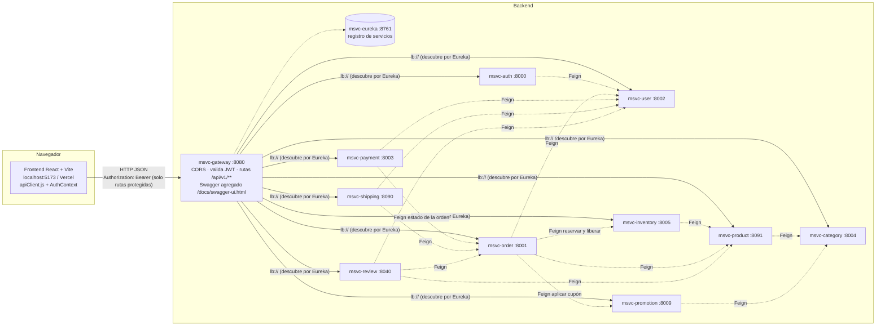
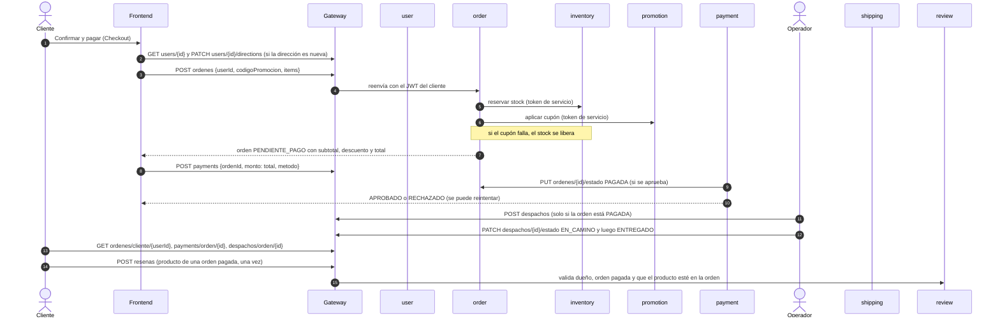

# Documento de integración: diagrama y tabla vista–endpoints

GameHub Store · EP3 · Grupo 13 · Sección de Facundo (C)

## 1. Diagrama front → Gateway → microservicios

Cada microservicio tiene su propia base H2 en archivo (`data/<servicio>_db`) y se registra en Eureka.

### Cómo viaja la petición

1. El front llama a `VITE_API_URL` (`http://localhost:8080/api/v1`). En las rutas protegidas, `apiClient` agrega `Authorization: Bearer <token>` con el token de la sesión de `AuthContext`.
2. El Gateway resuelve CORS, deja pasar sin token los GET públicos (productos, categorías, inventario, reseñas por producto y cupón por código) y `/auths/**`, y valida la firma del JWT en el resto. Luego enruta a cada servicio con `lb://`, buscándolo en Eureka.
3. El microservicio vuelve a validar el JWT y revisa el rol (`ROLE_USER`, `ROLE_OPERADOR`, `ROLE_ADMIN`) en su `SecurityConfig`. Order, payment y review además comprueban que el cliente sea dueño del recurso.
4. Las llamadas entre microservicios (líneas punteadas) usan Feign con un **token de servicio**: un JWT de 5 minutos, firmado con la misma clave compartida (`JWT_SECRET`) y con rol `ROLE_ADMIN`. Así, por ejemplo, el pago de un cliente puede marcar su orden como `PAGADA`, una operación que solo puede hacer ADMIN u OPERADOR.
5. Las respuestas vienen en formato HATEOAS: las listas llegan dentro de `_embedded` y `apiClient.extraerLista` las desenvuelve. Los errores llegan como `{ "error": "mensaje" }` o como un mapa campo → mensaje, y `utils/errores.js` los traduce para mostrarlos en pantalla.

### Flujo de compra (flujos 4 a 7)

## 2. Tabla vista–endpoints

Todos los endpoints van por el Gateway con el prefijo `/api/v1`. Las rutas marcadas como públicas se llaman sin `Authorization`.

| Vista (ruta) | Roles | Endpoints | Resp. |
|---|---|---|---|
| Inicio (`/`) | Todos | GET `productos` · GET `categories` · GET `inventories` (públicos) | A |
| Catálogo (`/catalogo`) | Todos | GET `productos` · GET `categories` · GET `inventories` (públicos) | A |
| Producto (`/producto/:id`) | Todos | GET `productos/{id}` · GET `categories` · GET `inventories/producto/{id}` (públicos) · GET `resenas/producto/{id}` (público; pendiente de B, hoy usa datos simulados) | B |
| Carrito (`/carrito`) | Todos (el visitante arma carrito) | GET `productos` · GET `categories` · GET `inventories` (públicos) · GET `promociones/codigo/{codigo}` (público; pendiente de B, hoy usa datos simulados) | B |
| Login (`/login`) | Visitante | POST `auths/login` · GET `users/email/{email}` · POST `auths/refresh` (renovación) | B |
| Crear cuenta (`/crear-cuenta`) | Visitante | POST `auths` · POST `auths/login` · POST `users` · GET `users/email/{email}` | B |
| Checkout (`/checkout`) | Cliente | GET `users/{id}` (datos precargados) · PATCH `users/{id}/directions` (solo si la dirección es nueva) · POST `ordenes` · POST `payments` (y reintento) | C |
| Mis órdenes (`/mis-ordenes`) | Cliente | GET `ordenes/cliente/{userId}` · GET `payments/orden/{id}` · GET `despachos/orden/{id}` · GET `productos/{id}` (nombres) · GET `resenas/usuario/{userId}` · POST `resenas` · POST `payments` (pagar pendiente) | C |
| Panel del operador (`/panel-operador`) · Órdenes | Operador, Admin | GET `ordenes/estado/{estado}` · GET `payments/orden/{id}` · GET `despachos/orden/{id}` · PUT `ordenes/{id}/estado` (cancelar pendiente) · GET `users/{id}` (dirección precargada) · POST `despachos` | C |
| Panel del operador · Pagos | Operador, Admin | GET `payments/estado/{estado}` · PATCH `payments/{id}/estado` (confirmar) · PATCH `payments/{id}/anular` | C |
| Panel del operador · Despachos | Operador, Admin | GET `despachos/estado/{estado}` · PATCH `despachos/{id}/estado` (con tracking y fecha de entrega) · PATCH `despachos/{id}/cancelar` | C |
| Panel del operador · Inventario | Operador, Admin | GET `productos` · GET `categories` · GET `inventories` · PATCH `inventories/{id}/cantidad` (registra el movimiento de ajuste) | C |
| Panel de administración (`/panel-admin`) | Admin | POST y PATCH `productos` · POST y PATCH `categories` · GET, POST y PATCH `promociones` · POST `inventories` · GET `resenas/producto/{id}` · PATCH `resenas/{id}/moderar` · GET `auths` · PATCH `auths/{id}/rol` | A |

### Reglas por rol de los servicios de la parte C

| Servicio | Cliente (USER) | Operador | Admin |
|---|---|---|---|
| order | Crear, ver y cancelar sus órdenes pendientes | Ver por estado y cambiar estado | Todo |
| payment | Pagar y ver pagos de sus órdenes | Ver por estado, confirmar y anular | Todo |
| shipping | Ver el despacho de su orden | Crear, avanzar y cancelar despachos | Todo |
| review | Reseñar lo comprado (orden pagada, una vez) | Ver | Todo, incluida la moderación |

### Estados que muestra el front

| Backend | En pantalla |
|---|---|
| Orden `PENDIENTE_PAGO` | Pendiente de pago |
| Orden `PAGADA` sin despacho | Pagada |
| Orden `CANCELADA` | Cancelada |
| Despacho `PENDIENTE` | Preparando |
| Despacho `EN_CAMINO` | En camino |
| Despacho `ENTREGADO` | Entregado |
| Despacho `CANCELADO` | Despacho cancelado |

Pago de prueba: con el método `RECHAZO_PRUEBA` ("Tarjeta de prueba (pago rechazado)" en el Checkout), el pago queda `RECHAZADO` y la orden sigue `PENDIENTE_PAGO`, para demostrar el reintento. Cualquier otro método se aprueba.

Garantías: quedan fuera de EP3 porque no existe un microservicio para ellas, y no aparecen en Mis órdenes ni en el Panel del operador.
