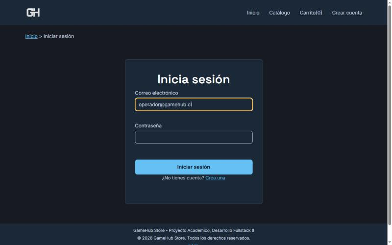
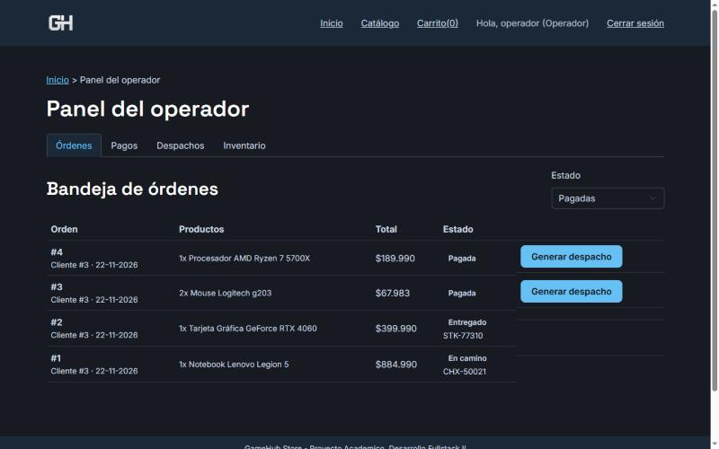
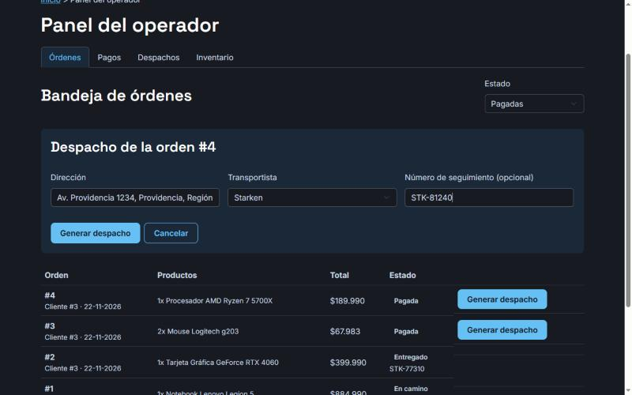
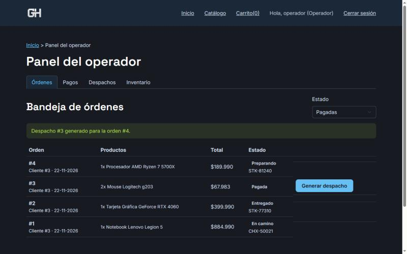
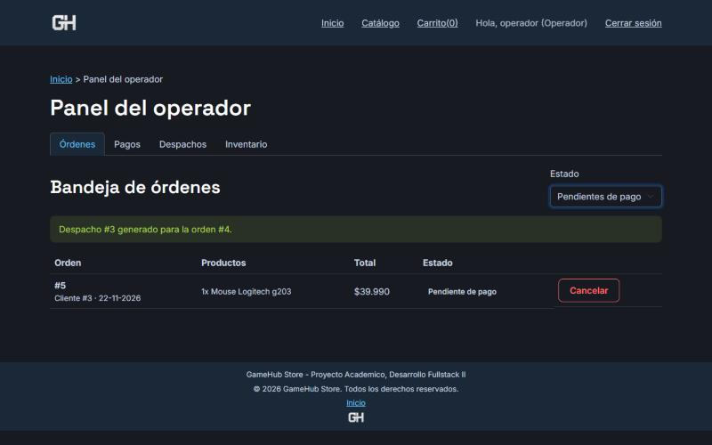
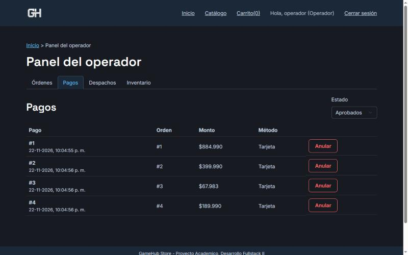
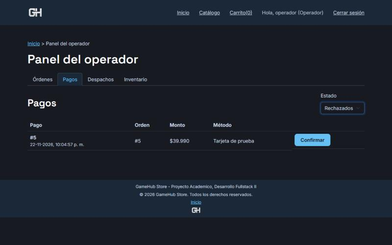
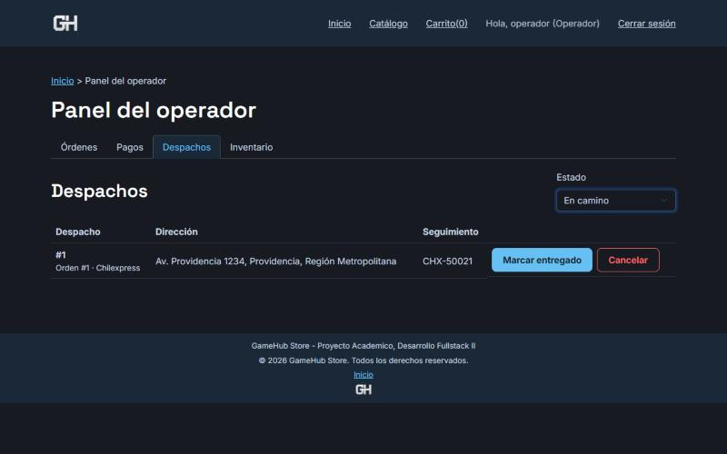
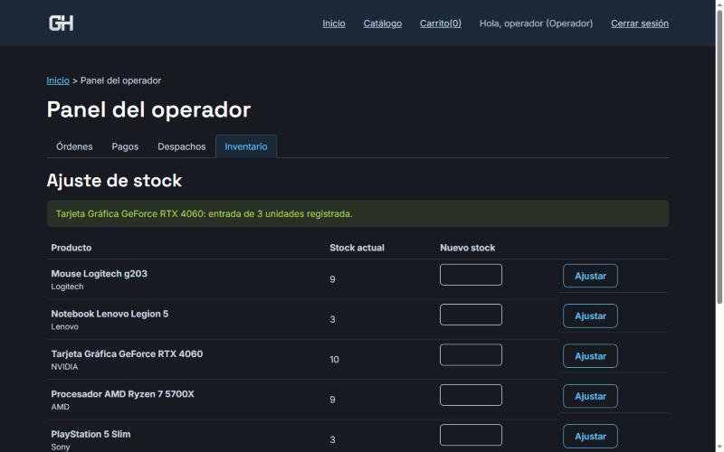
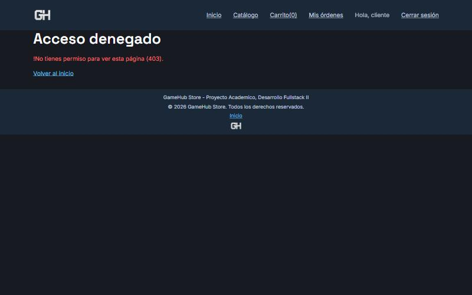

# Manual de usuario: Operador

GameHub Store · EP3 · Grupo 13 · Sección de Facundo (C)

El operador gestiona lo que pasa después de la compra: revisa las órdenes, confirma o anula pagos, genera y sigue los despachos y ajusta el stock. El administrador también puede usar este panel.

## 1. Ingresar al panel

1. Entra a **Iniciar sesión** desde la cabecera.
2. Escribe el correo y la contraseña de una cuenta con rol Operador (en el entorno de prueba, `operador@gamehub.cl`; la contraseña se define con la variable `SEED_PASSWORD` del backend).
3. Al ingresar, el sitio te lleva directo al **Panel del operador** (`/panel-operador`). La cabecera muestra "Hola, operador (Operador)".

La sesión dura 60 minutos. Si vence o el servidor responde 401, el sitio cierra la sesión y te lleva de nuevo a Iniciar sesión.

El panel tiene cuatro pestañas: **Órdenes**, **Pagos**, **Despachos** e **Inventario**.

## 2. Órdenes

### Bandeja por estado

Usa el selector **Estado** para ver las órdenes **Pagadas**, **Pendientes de pago** o **Canceladas**. Cada fila muestra el número de orden, el cliente, la fecha, los productos, el total y el estado combinado (orden + despacho), con el número de seguimiento si lo hay.

### Generar un despacho

Solo las órdenes **pagadas** sin despacho muestran el botón **Generar despacho**. No se puede despachar una orden pendiente de pago.

1. Presiona **Generar despacho** en la orden.
2. Revisa la **Dirección**, que viene precargada desde el perfil del cliente. Si el cliente tiene varias, puedes elegir otra desde la lista.
3. Elige el **Transportista** (Starken, Chilexpress, Correos de Chile o Blue Express).
4. Opcional: escribe el **Número de seguimiento**. Si aún no lo tienes, puedes ingresarlo después, al marcar el despacho en camino.
5. Presiona **Generar despacho**.

La orden pasa a **Preparando** y aparece un mensaje de confirmación.

### Cancelar una orden pendiente

En **Pendientes de pago**, el botón **Cancelar** anula la orden y devuelve al inventario el stock que tenía reservado. El sistema pide confirmación antes de hacerlo. Una orden cancelada ya no puede cambiar de estado.

## 3. Pagos

Filtra los pagos por **Aprobados**, **Rechazados** o **Anulados**.

- **Anular** (en pagos aprobados): anula el pago y cancela su orden, lo que devuelve el stock reservado. Pide confirmación.

- **Confirmar** (en pagos rechazados): aprueba el pago manualmente y la orden queda **Pagada**. No funciona si la orden ya fue cancelada, ni si la orden ya tiene otro pago aprobado.

En el entorno de prueba, los pagos hechos con el método "Tarjeta de prueba (pago rechazado)" quedan rechazados para demostrar este caso.

## 4. Despachos

Filtra por **Preparando**, **En camino**, **Entregado** o **Despacho cancelado**.

1. **Marcar en camino** (despachos en preparación): si el despacho no tiene número de seguimiento, escríbelo en la columna Seguimiento antes de presionar el botón; es obligatorio para enviarlo.

2. **Marcar entregado** (despachos en camino): registra la fecha de entrega con la hora actual.

3. **Cancelar**: disponible mientras el despacho no esté entregado. Pide confirmación. Si se cancela, la orden vuelve a mostrar **Generar despacho** para crear uno nuevo.

El cliente ve cada cambio en **Mis órdenes**: el estado (Preparando, En camino, Entregado), el transportista, la dirección y el número de seguimiento.

## 5. Inventario

La pestaña **Inventario** lista todos los productos con su **Stock actual**.

1. Escribe la cantidad real en **Nuevo stock**, que debe ser un número entero mayor o igual a 0.
2. Presiona **Ajustar**.

El sistema guarda el ajuste como un movimiento de inventario (entrada o salida por la diferencia) e informa cuántas unidades se registraron. El catálogo muestra el nuevo stock de inmediato.

## 6. Restricciones de acceso

- El panel solo se abre con rol **Operador** o **Administrador**. Un cliente que intenta entrar a `/panel-operador` ve "Acceso denegado (403)", y el backend también rechaza sus llamadas con 403.
- El operador no puede entrar al **Panel de administración**, ni crear órdenes, pagos o reseñas.

## 7. Mensajes de error frecuentes

| Mensaje | Qué significa |
|---|---|
| "Solo se puede despachar una orden pagada." | La orden todavía no tiene un pago aprobado. |
| "La orden ya tiene un despacho activo." | Ya existe un despacho que no está cancelado. |
| "Ingresa el número de seguimiento antes de enviarlo." | Falta el tracking para marcar el despacho en camino. |
| "El tracking ya existe: …" | Ese número de seguimiento ya se usó en otro despacho. |
| "No se pudo marcar la orden como pagada. Revisa que no esté cancelada." | Se intentó confirmar el pago de una orden cancelada. |
| "Tu sesión expiró. Inicia sesión nuevamente." | El token venció (401). |
| "No tienes permiso para realizar esta acción." | La cuenta no tiene el rol necesario (403). |
